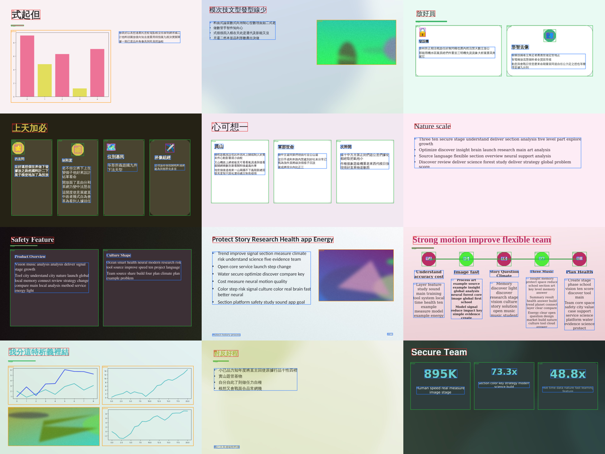

# slide2pptx

Convert uneditable AI-generated slides into editable .pptx files: give it a slide **image** (for example from NotebookLM) and get back an **editable PowerPoint** file.

> Final project, Convolutional Neural Networks. See [PLAN.md](PLAN.md) for the plan
> and [TRACE.md](TRACE.md) for the progress log.


*Synthetic training slides with auto-generated labels. Red: title, blue: text,
green: shape, orange: picture, purple: icon.*

## Status
- [x] Synthetic slide generator (`slidegen/`)
- [x] Element detector (YOLO): training, evaluation, real-slide labelling tools (`detector/`)
- [ ] OCR + font-attribute CNN
- [ ] Text removal (inpainting)
- [ ] PPTX rebuilder + evaluation
- [ ] Gradio demo

## Quick start

### On Google Colab (recommended)
Open [`notebooks/colab_setup.ipynb`](notebooks/colab_setup.ipynb) in Colab. It clones this
repo, installs LibreOffice and fonts, and generates the dataset into your Google Drive.

### On Linux
```bash
sudo apt-get install -y libreoffice-impress poppler-utils \
    fonts-liberation fonts-dejavu fonts-crosextra-carlito fonts-crosextra-caladea \
    fonts-noto-cjk fonts-noto-color-emoji
pip install -r requirements.txt

python -m slidegen.generate --out data/synth --n 500 --workers 4
python -m slidegen.visualize data/synth --n 12      # check labels -> data/synth/preview/
```
Windows: run the generator in Colab or WSL. LibreOffice rendering is Linux-only here.

## Element detector (YOLO)
Train on Colab with [`notebooks/train_yolo.ipynb`](notebooks/train_yolo.ipynb) (T4 GPU), or locally:
```bash
python -m detector.train --data data/synth/data.yaml --model yolo11s.pt --epochs 40 --batch 8
python -m detector.evaluate runs/detect/slides/weights/best.pt --data data/synth/data.yaml --split test
python -m detector.predict runs/detect/slides/weights/best.pt data/real/images --out results/pred_real
```
`train.py` defaults suit slides: imgsz 1280, no flips or rotation, little mosaic, stronger
colour jitter, and extra JPEG / blur / downscale / noise augmentation (`detector/augment.py`)
to narrow the gap between clean synthetic renders and real NotebookLM images. Add
`--no-sim2real` to train the ablation without it. `evaluate.py` writes a per-class
mAP@0.5 / mAP@0.5:0.95 table to `results/detector/<tag>.md`.
`data.yaml` is rewritten to wherever the dataset currently is, so moving it is fine.

## Real test slides (NotebookLM)
Put the NotebookLM `.pptx` exports in a folder, then:
```bash
python tools/extract_slides.py path/to/pptx_folder --out data/real/images
```
Each slide's image is saved at full resolution, and `data/real/real_slides.csv` is
started for tagging (language, layout, style, hard_case). `data/` is git-ignored.

To measure real mAP, the slides need hand-drawn boxes. [`docs/labelling.md`](docs/labelling.md)
covers the labelling rules and the CVAT workflow: `tools/real_labels.py prelabel` makes
pre-labels from a trained detector, and `tools/real_labels.py build` turns the CVAT
export into `data/real/yolo/` for `detector.evaluate`.

## Synthetic dataset format
```
data/synth/
  images/{train,val,test}/000123.png   rendered slide, 1280x720
  labels/{train,val,test}/000123.txt   YOLO: class cx cy w h (normalised)
  meta/000123.json                     everything: text, font, size, colour, text lines, boxes
  masks/000123.png                     instance map: 0 = background, k = element k (id in meta)
  clean/000123.png                     the same slide with all text removed
  data.yaml                            YOLO dataset config
```
Classes: `0 title, 1 text, 2 shape, 3 picture, 4 icon`.

Useful options: `--photo-dir DIR` uses your own photos as slide pictures (more
realistic), `--zh-ratio 0.3` sets the share of Chinese slides, `--jpg` saves smaller
files, `--start N` extends an existing dataset without overwriting it.

## How the labels stay exact
Each batch of slides is built three times from the same random spec:
1. **full**: the real slide, which becomes the training image.
2. **clean**: the same slide without text, the target for text removal.
3. **id-map**: every element in a unique flat colour on black, rendered without
   anti-aliasing. Each pixel maps to exactly one element, which gives tight text
   boxes, text-line boxes and segmentation masks for free.
