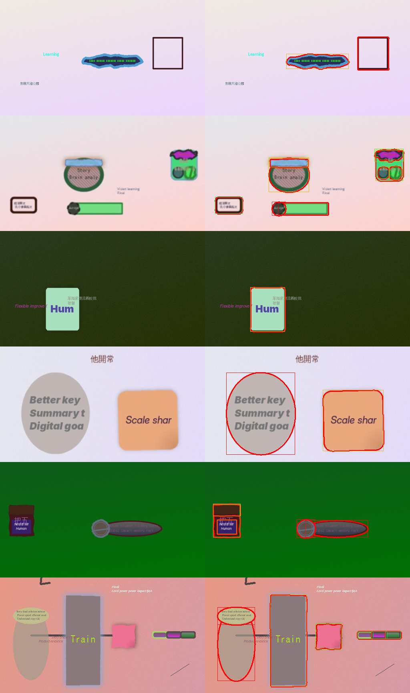

# Two-level box detection (experimental branch)

**Status:** prototype on branch `claude/project-thread-jkuii6`. Main and the Stage 2 YOLO work
are untouched; everything lives in `boxseg/` plus `notebooks/train_boxseg.ipynb`.

## Why
The YOLO detector learns the *styles* it was trained on. Real NotebookLM slides contain
styles the generator never produced (hand-drawn frames, sticky notes, neon glow, torn paper),
and recall on those is low. Adding each style to the PowerPoint generator one by one does not scale.

Idea: split the problem in two, and make the first part style-blind on purpose.

1. **Level 1: where are the closed regions?** Class-agnostic. Every box, card, circle, pill,
   sticky note: anything with a closed outline or a filled region. No classes, so there is
   nothing style-specific to learn.
2. **Level 2: which boxes belong together?** A card and its header strip, a number badge and its
   label, a stack of cards. These become one group in the rebuilt .pptx.

## How it fits the course (convolution)
Both levels are CNNs; classical CV is only a baseline.

| Part | Network | Why convolution fits |
|---|---|---|
| Level 1 | **U-Net** (encoder-decoder with skip connections), 2 output maps: *inside* and *edge* | Dense per-pixel prediction. The encoder's growing receptive field decides "is this outline closed?", the skips keep edges sharp. Same idea as boundary-aware cell segmentation (DCAN) |
| Level 2 | **Pair CNN**: 5-channel input (RGB crop + mask of box A + mask of box B) → conv layers → + 8 geometry numbers → same-group probability | The CNN reads visual evidence between the two boxes (shared panel, touching borders, matching style); masks as extra input channels is a standard way to tell a CNN *which* objects to compare |
| Baseline | Canny + contour tree (OpenCV) | No learning; shows what the CNN adds |

Boxes come from the maps by connected components of `inside AND NOT edge`: the edge map is what
separates nested or touching boxes (card vs. its header) that the inside map alone would merge.

## Data: style randomisation (domain randomisation)
`boxseg/synth.py` draws slides directly with numpy/OpenCV (about 0.1 s each, no LibreOffice), so
training data is generated on the fly and never repeats. Each box gets random combinations of:

- shape: rectangle, rounded, ellipse, rotated (sticky)
- outline: none, solid, dashed, double, **hand-drawn** (wobbly, 1-2 overlapping strokes, open ends)
- fill: none, solid, translucent, gradient, hatching
- effects: **drop shadow, glow, sticky-note curl**
- background: flat, gradient, paper/grunge noise, grid paper, optionally blurred real slides (`--bg-dir`)
- distractors that are *not* boxes: connectors and arrows, scribbles, text in and outside boxes
- degradation: blur, JPEG, down-scaling

Widgets give the group labels for free: `single`, `card` (+ header, inner boxes, icon circle),
`badge` (circle overlapping a label), `stack`, `sticky`, `pills` (touching segments).



*Left: generated slide. Right: edge target in red, boxes coloured by group.*

## Experiments (for the report)
1. **U-Net vs contours** on synthetic test scenes: P/R/F1 at IoU 0.5 and 0.75, recall per style.
2. **Held-out style:** train without `hand` and `sticky`, test only on those boxes. If recall stays
   close to the full model, the network learned geometry, not style. This is the main claim.
3. **Level 2 alone vs end to end:** pair accuracy and exact multi-box group recovery, on
   ground-truth boxes and on the U-Net's boxes.
4. **Real slides:** the 20 hand-labelled NotebookLM slides. Compare recall of `shape` boxes with
   YOLO (class-agnostic matching), and look at the failure cases.

## Commands
```bash
python -m boxseg.synth --n 8                     # preview -> docs/img/boxseg_samples.png
python -m boxseg.train seg   --steps 8000 --batch 16 --out runs/boxseg
python -m boxseg.train group --steps 4000 --batch 64 --out runs/boxseg
python -m boxseg.evaluate --seg runs/boxseg/seg.pt --group runs/boxseg/group.pt --n 300
python -m boxseg.predict runs/boxseg/seg.pt data/real/images --group runs/boxseg/group.pt --baseline
```
### On Colab (the main way to train)
`notebooks/train_boxseg.ipynb` runs everything as **one background job** with
`tools/colab_job.py`, so it does not depend on the browser page:

- the job is started with `setsid`/`nohup`; closing or reloading the page, or the page losing its
  connection, does not stop it. Its log is `runs/boxseg/boxseg.log` on Drive;
- `boxseg.train` saves model + optimiser + LR schedule every 250 steps (`--save-every`) and, by
  default (`--resume auto`), continues from that checkpoint or skips a finished stage;
- so after a runtime reset you run cells 1-3 again and lose at most 250 steps.
  Starting a job that is already running does nothing, so re-running cells is always safe.

`tools/colab_job.py start|status|stop NAME --dir DIR -- "<command>"` works for any long job
(the YOLO sweep too), from a notebook cell or the Colab terminal.

## Known limits / open decisions
- **What is a group?** Here: one widget. A big panel containing several cards is its own group,
  not the parent of the cards. Real decks are ambiguous; this needs a rule like the labelling rules.
- A box whose visible part is cut by a child touching its border (card with header strip) gets a
  box from its visible part only, slightly too small. A third output (per-pixel distance to the
  box border, or an amodal mask) would fix this.
- Two touching boxes with the same fill and no outline are invisible as two boxes, by design.
- Pictures and icons are not drawn yet; on real slides the U-Net may fire on photos.
- Level 1 is class-agnostic: text vs shape vs picture still comes from YOLO or a small classifier
  on the crops.
